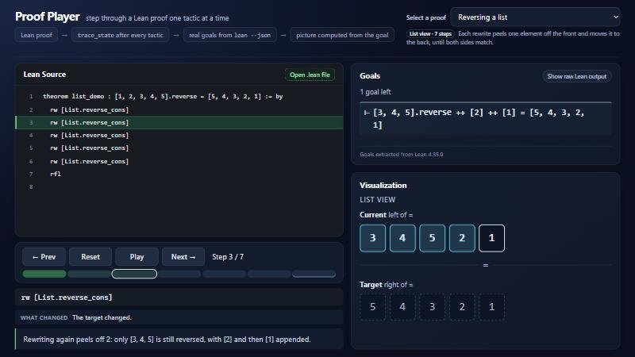
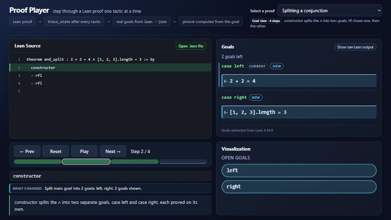

# Proof Player

**Step through a Lean 4 proof one tactic at a time, like scrubbing a video.** After every line you see exactly what Lean still has to prove, what that line changed, and a picture of it: list boxes that rearrange, a path that grows through a graph, goals that split and close.

Syntax Error 2026, Functional Programming track (FP Launchpad, problem 3).

**Live demo:** https://proof-player-eight.vercel.app/



## The problem

A finished Lean proof is a wall of tactics. Each line transforms an invisible proof state, and the only way to see it is to open an editor with Lean installed and click through line by line. That's a real barrier for students and for anyone reviewing a proof.

Proof Player makes the state visible: pick a proof, press **Play** or **→**, and watch the goals, the changes and the picture move with the highlighted line.

## Trust: what comes from Lean, and what we add

| Comes from Lean (facts) | Added by Proof Player (interpretation) |
|---|---|
| Every goal, hypothesis, `⊢` target and `case` name, captured by inserting `trace_state` after each tactic and running `lean --json` | **What changed**: a comparison of two consecutive Lean states |
| The exact text Lean printed at each step (**Show raw Lean output**) | The **pictures**, computed only from that goal text |
| The Lean version (4.35.0), shown under the goals | The one-sentence **explanations** for the built-in samples, written by us and stored separately |

`npm test` re-parses every committed trace from Lean's raw output and fails if the goals don't match exactly, so the displayed states can't drift from what Lean said.

```
samples/*.lean ─► insert trace_state after every tactic ─► lean --json ─► parse goals ─► src/data/traces/*.json ─► app
```

## Using it

- **Select a proof**: the badge shows which picture it uses and how many steps it has.
- **Prev / Next** or `←` / `→` step; **Home** / **End** jump to the first and last step; **Reset** goes back to the start.
- **Play** (or `Space`) steps once a second and stops by itself at the end; any other control pauses it.
- **Timeline**: one marker per step, cyan where goals split and green where goals close. Click a marker to jump straight to that step.
- **What changed**: a summary of the transition, for example "Split main goal into 2 goals: left, right." or "Closed left."
- **Goals**: case names, hypotheses and target. New and changed lines are highlighted, `current` marks the goal Lean works on next, long hypothesis lists collapse, and every line has a **Copy** button.
- **Show raw Lean output**: swaps the parsed goals for Lean's exact `trace_state` text.



## How "What changed" is computed (and what it won't claim)

`src/lib/transition.ts` compares the goal lists before and after each step:

- Goals are matched by Lean's case tags (`left`, `left.right`, …), by one goal staying one goal, or by one goal splitting into several. Hypotheses are compared one name at a time, so Lean regrouping `xs ys : List Nat` isn't reported as a change.
- Inside a `·` block or a `| case =>`, Lean shows only the focused goal. A goal that disappears is therefore called **closed** only when nothing else changed in that step. If the step visibly worked on another goal, the missing ones are reported as **still open, set aside**.
- When several untagged goals can't be matched, it says "Goal structure changed" and makes no per-goal claims.
- "Proof complete" is shown only when the **last** step has no goals.

## How the pictures are derived

Each picture is a pure function of the goals at that step, with no step numbers involved:

- **List view**: the elements of the list literals on each side of `=`; boxes that moved are lit.
- **Graph view**: `(a, b)` pairs found in the hypotheses become edges, and the newest one is labelled. The filled node is the second-to-last number in the target (`Reach E 5 6` → 5).
- **Goal view**: one chip per goal Lean reports; chips appear on a split and get a ✓ when closed.

If a state doesn't contain what the picture needs (no list literal, no pairs), the panel says so and shows the open goals instead of drawing something misleading.

## Run it

```bash
npm install
npm run dev
```

You don't need Lean to run the app: the traces are committed JSON, and it works offline.

## Open your own .lean file

Click **Open .lean file** in the Lean Source panel, or drag a `.lean` file onto the page. The same extractor runs on it, and it opens at step 1, marked "uploaded", with the picture picked from its goals.

- **Locally:** `npm run dev` on a machine with Lean ([elan](https://github.com/leanprover/elan)) uses your Lean.
- **On the live site:** uploads go to the public Lean server (see Deployment). If it's offline, the button doesn't appear.
- **Supported layouts:** one theorem per file (definitions and inductive types before it are fine), one tactic per line, `induction … with` / `cases … with` with `| case =>` alternatives (including one-line `| zero => rfl`), and `·` bullets. Core Lean only, no Mathlib.
- **Errors:** the card says whether **Lean rejected the proof** (Lean's own error plus your offending line), the **layout isn't supported**, the file is **not allowed on the public server**, or a limit or connection failed. Each card has buttons to open another file or go back to the examples.
- **Examples to try:** `examples/` (maze_escape, big_reverse, goal_tree, bool_cases).

## Known limitations

- The extractor reads one theorem per file and one tactic per line; tactics split across lines are rejected with a clear message.
- The list and graph pictures recognise specific shapes: list literals around `=`, and `(a, b)` pairs. Other proofs use the goal view.
- Snapshots inside a focused `·` / `| case` block only show that branch, so the goal view can't show every open goal at those steps. "What changed" says so explicitly.
- Uploaded proofs have no hand-written explanations; the panel says so instead of inventing one.
- Live upload depends on the Lean server being up (see below).

## Checks

```bash
npm test        # 66 tests
npm run lint
npm run build   # type-check and production build
npm run traces  # regenerate traces (needs Lean); git should show only date changes
```

The tests cover:
- the pictures on real traces, and both panels at every step of every proof;
- every trace re-parsed from Lean's raw output, plus trace validation;
- the extractor's placement rules and the public-server rules;
- the transition engine (matching, closed vs set aside, uncertain cases);
- playback (clamping, autoplay stop, keys ignored while typing, disabled states, the timeline, the active source line);
- the goal inspector, the visualization fallback, and upload error handling against a fake server.

GitHub Actions runs the UTF-16 file check, lint, build and tests on every PR and push to `main`.

## Deployment

- **Frontend:** static Vite build on Vercel, deployed automatically from `main`.
- **Lean server:** `lean-server/server.mjs` runs the extractor behind `scripts/lean-api.mjs`. Vercel can't host Lean (its 250 MB function limit is smaller than Lean's core runtime), so the frontend calls this server at the address in `VITE_LEAN_API` (`.env.production`).
- **Right now** it runs on a team laptop through a Cloudflare quick tunnel:
  - `npm run live` starts the server and tunnel and pushes the new address;
  - `npm run live:stop` stops both.
- **To host it permanently:** `lean-server/Dockerfile` (Lean 4.35.0) runs on any Docker host, for example a Hugging Face Space (`npm run space`) or Railway (`railway.toml`).
- **Public-server limits:**
  - only plain definitions and proofs (no `#` commands, `import`, IO, custom syntax or raised limits);
  - 50 KB per file and 20 s of Lean time;
  - 15 uploads per minute per client;
  - only this site may call it from a browser.

  These checks run on the server, not just in the browser.

## Regenerating traces (needs Lean)

```bash
npm run traces
```

Run one sample only: `npm run traces -- list_demo`. If `lean` isn't on PATH or in `~/.elan/bin`, set `LEAN` to its path.

To add a sample:
1. Write `samples/<id>.lean`.
2. Add `{ id, title, description, viz }` to `samples/index.json`. Its order is the dropdown order, and `viz` is `list`, `graph` or `goal`.
3. Optionally add `explanations/<id>.json`, with one sentence per step describing the state *after* that line.
4. Run `npm run traces` and commit `src/data/traces/<id>.json`.

## Repository layout

| Path | What |
|---|---|
| `samples/`, `explanations/` | Clean `.lean` samples (no `trace_state`), plus one sentence per step |
| `scripts/extract-traces.mjs` | Inserts `trace_state`, runs `lean --json`, writes traces |
| `scripts/lean-api.mjs`, `lean-server/` | Upload API (dev server and public server), plus the Docker image |
| `src/types/proof.ts` | The contract between extractor and app |
| `src/lib/transition.ts` | State comparison ("What changed", highlights, timeline) |
| `src/lib/playback.ts`, `src/hooks/` | Playback rules and player state (one step index drives every panel) |
| `src/components/`, `src/viz/` | Shell, code viewer, controls, goal panel, visualizations |
| `tests/` | `npm test` |
| `examples/` | Extra `.lean` files to upload |
| `DEMO.md` | 2-minute demo script |

## Extractor notes

- `lean` stdout is read as **UTF-8**. On Windows the default decoding garbles `⊢` into `⊢`.
- Where `trace_state` goes:
  - after a tactic: at that tactic's indent;
  - after a line ending in `by` or `=>`: at the next line's indent;
  - after a one-line `| case => tac`: on the same line, twice (the case's goal, then after `tac`);
  - after a one-line `·` bullet: at the bullet's indent;
  - after a `·` bullet that opens a block: at its indent + 2;
  - never directly after a line ending in `with`.
- Lean errors are reported with the line number in the original file.

## Team rules

- `main` always runs, and CI must be green before merging.
- Work on a branch from a fresh `main` and open a PR.
- Save files from the editor, not with PowerShell `>` (it writes UTF-16).
